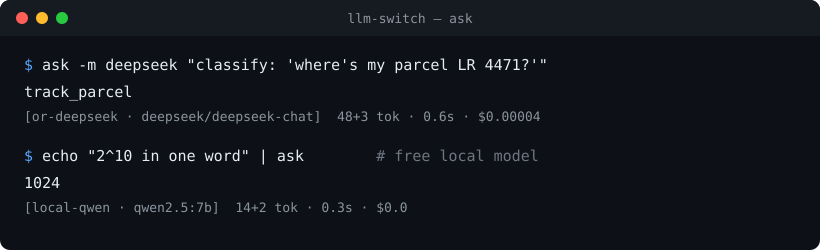

# llm-switch

**One interface for local, cloud open-weight, and frontier LLMs — plus a built-in
cost/latency compare harness.** Call Ollama, OpenRouter, Groq, or Claude through a
single `chat()` function; the only thing that changes is the model name.

The point: move high-volume, scoped work (classification, extraction, templated
replies) off expensive frontier APIs onto cheap open-weight models — but *measure
first*, and keep the frontier for the hard calls.

<p align="center"></p>

```python
from llm import chat
print(chat("local-qwen",  "Summarize: ...")["text"])   # free, offline
print(chat("or-deepseek", "Summarize: ...")["text"])   # cheap, cloud open-weight
print(chat("or-claude",   "Summarize: ...")["text"])   # frontier baseline
```

Every backend is OpenAI-compatible, so one small client talks to all of them.

## What's inside

| File | What it does |
|------|--------------|
| **`llm.py`** | Unified client + a model registry with per-model pricing. `chat()` returns text **and** token counts, latency, and computed cost. |
| **`cli.py`** (`ask`) | A one-shot terminal LLM. Defaults to the free local model; pipe stdin in; pick a bigger model with `-m`. Footer (cost/latency) goes to stderr so pipes stay clean. |
| **`compare.py`** | Run the same prompts across several models and print quality + latency + cost side by side — your decision tool for *"is the cheap model good enough on my task?"* |

## Quick start

```bash
git clone https://github.com/Iniyarajan/llm-switch
cd llm-switch
python -m venv .venv && source .venv/bin/activate
pip install -r requirements.txt

cp .env.example .env         # add an OpenRouter key (and/or Groq / Anthropic)
python llm.py                # smoke test (needs a local Ollama model, or edit to a cloud key)
```

Full walkthrough in **[QUICKSTART.md](QUICKSTART.md)**.

## The `ask` command

```bash
# optional: a short alias
echo "alias ask='python3 \"$PWD/cli.py\"'" >> ~/.zshrc && source ~/.zshrc

ask "what is a closure in JS"            # free local model
cat error.log | ask "explain this"       # pipe anything in
ask -m deepseek "classify intent: ..."   # cheap cloud open-weight
ask --models                             # list models + prices
```

## Why

Frontier models are the right tool for hard, agentic, multi-step work. But a lot of
production LLM calls are *simple and high-volume* — and there, a good open-weight
model at a fraction of the price is often indistinguishable. `compare.py` lets you
prove that on your own data before you switch a route and cut the bill.

> Open-weight doesn't always win. Run `compare.py` on **your** tasks and decide per
> route — the cheapest model that still passes is the right one.

## License

MIT © Iniyarajan — [iniyarajan.dev](https://iniyarajan.dev)
